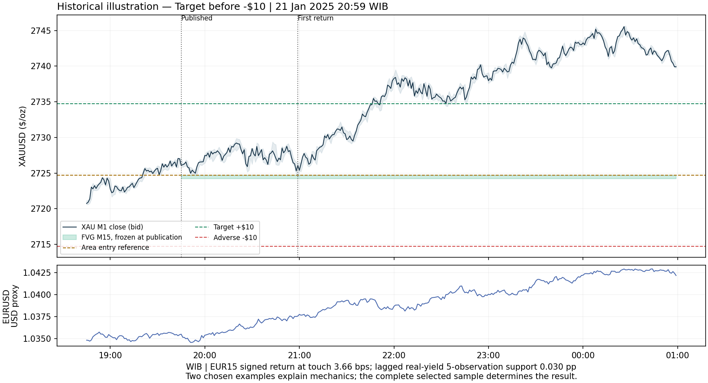
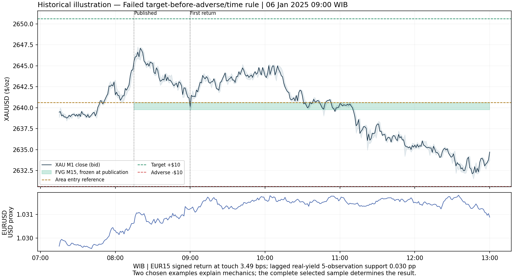

# RIZAN — zona pantul XAUUSD minimal $10/ons

Riset 17 November 2026. Status: eksperimen historis, belum layak diberi label peluang 80%. Manual R3 dan strategi LIVE tidak diubah oleh riset ini.

**Temuan utama:** zona dapat didefinisikan sebelum harga kembali, tetapi nama supply–demand, order block, atau FVG tidak otomatis menghasilkan probabilitas tinggi. Pada 60 model yang dipilih menggunakan periode pengembangan, tidak ada yang mencapai 80% pada 2025 dengan minimal 100 kejadian, termasuk skenario yang mengizinkan gerak melawan $20 untuk mengejar $10. Ini bukan pembuktian bahwa semua strategi zona mustahil; ini hasil untuk definisi, data, dan jendela waktu yang dijelaskan di bawah.

## Apa sebenarnya zona?

Zona adalah **rentang harga yang mempunyai alasan terukur untuk diperhatikan ketika harga kembali**, dengan waktu mulai berlaku, batas atas/bawah, dan syarat pembatalan. Zona bukan sebuah harga ajaib. CME juga membahas support/resistance sebagai area yang dapat berasal dari swing, rata-rata bergerak, harga penting, atau garis tren; level yang ditembus dapat berubah peran. [CME](https://www.cmegroup.com/education/courses/technical-analysis/support-and-resistance).

Contoh hipotetis demand 3.900–3.904: 3.904 adalah sisi terdekat saat harga turun dari atas (*proximal*); 3.900 sisi terjauh (*distal*). Target pantulan $10 dari referensi 3.904 berarti 3.914. Itu berbeda dari pantulan $10 yang dihitung dari titik terendah belakangan diketahui. Pada supply, arahnya dibalik.

Perdagangan selalu mempertemukan pembeli dan penjual. Harga dapat berubah karena pihak yang agresif menghabiskan likuiditas pada harga tertentu, penawaran ditarik, atau kuotasi bergeser. Pernyataan “jumlah pembeli lebih banyak daripada penjual” tidak cukup untuk menjelaskan setiap transaksi. Data candle memperlihatkan hasil harga, bukan identitas institusi maupun semua order tersembunyi.

## Bagaimana zona terbentuk?

1. Harga sempat berkumpul atau membentuk ekstrem. Ini memberikan batas yang dapat dicatat.
2. Harga meninggalkan area. Dalam pendekatan supply–demand, trader memperhatikan base sebelum perpindahan cepat. Istilah rally–base–drop, drop–base–rally, rally–base–rally, dan drop–base–drop menjelaskan susunan harga, bukan kepastian pantulan.
3. Setelah keberangkatan selesai, area baru boleh dipublikasikan sebagai kandidat. Menggambar base lebih awal dengan memakai breakout yang belum terjadi adalah kebocoran informasi masa depan.
4. Saat harga kembali, minat yang tersisa, order baru, pengambilan untung, atau perubahan persepsi nilai dapat memicu reaksi. Dugaan “masih ada order institusi yang belum terisi” adalah hipotesis; tidak dapat dipastikan dari OHLC saja. CMC sendiri menekankan ketidakpastian interpretasi ini. [CMC](https://www.cmcmarkets.com/en-gb/technical-analysis/what-is-supply-and-demand-in-trading).
5. Jika tekanan yang datang lebih kuat, zona dapat ditembus. Rangkaian stop dapat mempercepat pergerakan. Jadi area yang sama bisa menghasilkan pantulan atau percepatan breakout.

Ada bukti mikrostruktur yang lebih kuat daripada cerita chart: studi Carol Osler pada order sebuah bank dealing FX menemukan pengelompokan order di angka bulat; take-profit dan stop-loss mempunyai dampak berbeda terhadap kelanjutan tren. Studi lain menguji level support/resistance dari enam firma FX dan menemukan hasil yang bervariasi antar mata uang/firma. Ini mendukung kemungkinan mekanisme reaksi harga, **bukan bukti bahwa zona emas tertentu mempunyai peluang 80%**. [New York Fed 2001/2003](https://www.newyorkfed.org/research/staff_reports/sr125.html), [New York Fed 2000](https://www.newyorkfed.org/research/epr/00v06n2/0007osle.html).

## Peta jenis zona menurut pendekatan trader

| Jenis | Dasar pembentukan | Cakupan uji ini |
|---|---|---|
| Support/resistance swing | Ekstrem yang sudah terkonfirmasi | Pivot baru M15/H1/H4; pembanding swing H1/H4 sesi |
| Supply/demand | Base kecil diikuti displacement dan break struktur | Proksi satu candle base, bukan seluruh variasi base 1–4 candle |
| Order block | Candle berlawanan sebelum displacement | Proksi OHLC dengan break enam bar sebelumnya; bukan bukti order institusi |
| FVG | Wick candle pertama dan ketiga tidak bertumpang tindih | M15/H1/H4, berlaku setelah candle ketiga selesai |
| Break–retest / perubahan peran | Harga menutup melewati ekstrem sebelumnya, lalu kembali | Break enam bar teramati; bukan implementasi lengkap semua breaker/mitigation block ICT |
| Area asal sweep | Harga melampaui ekstrem lalu kembali masuk | Zona dipublikasikan setelah sweep; yang diuji kunjungan berikutnya |
| Garis tren/channel | Hubungan ekstrem yang sudah diketahui | Garis tren H1 pembanding dari riset sebelumnya |
| Zona dinamis | Penyimpangan dari rata-rata/volatilitas | Keltner dan Bollinger M15 yang dibekukan pada awal sesi |
| High/low sesi/hari | Batas rentang periode yang telah selesai | Hari sebelumnya dan Asia box pembanding |
| Angka bulat / Fibonacci | Konvensi level atau rasio geometris | Dibahas sebagai konsep; belum diuji tersendiri di eksperimen ini |
| VWAP / anchored VWAP | Harga rata-rata berbobot volume dari suatu awal | Belum diuji; arsip input tidak memiliki volume transaksi yang memadai |
| Volume profile / order-book heatmap | Distribusi volume per harga atau likuiditas yang ditampilkan | Belum diuji; tidak boleh disimpulkan dari OHLC saja |

FVG bukan berarti tidak ada transaksi sama sekali pada rentang itu: candle tengah telah melewatinya. Ia berbeda dari gap pembukaan pasar. Penamaan *fair value* juga tidak membuktikan harga fundamental wajar atau kewajiban harga untuk kembali mengisinya. [TMGM](https://www.tmgm.com/en-eu/academy/trading-academy/fair-value-gap).

Aturan menggambar wick–body, jumlah candle base, dan pilihan entry proximal atau tengah berbeda antar trader. Karena itu backtest memerlukan satu definisi eksplisit. Edukasi CMC Funded memberi contoh base dan FVG, tetapi narasi tentang order yang tertinggal tetap perlu diuji secara independen. [CMC Funded](https://cmcmarketsfunded.com/academy/technical-analysis/supply-demand-and-fair-value-gaps/).

Spot emas mempunyai pasar OTC bilateral yang penting; chart satu broker tidak sama dengan seluruh buku order emas. Volume dan order flow COMEX dapat menjadi sumber tambahan, tetapi membutuhkan data serta penyesuaian hubungan futures–spot. [LBMA](https://www.lbma.org.uk/publications/the-otc-guide/introduction). Definisi VWAP dan volume profile dapat dilihat pada dokumentasi penyedia [VWAP](https://www.tradingview.com/support/solutions/43000502018-volume-weighted-average-price-vwap/) dan [volume profile](https://www.tradingview.com/support/solutions/43000502040-volume-profile-indicators-basic-concepts/).

## Kontrak pengujian $10

- Input: 2.557.244 candle bid M1 XAU, 1 Januari 2019 23:00 UTC sampai 31 Maret 2026 23:59 UTC. EURUSD M1 diselaraskan menurut waktu, bukan nomor bar.
- Enam keluarga struktural, tiga timeframe, ditambah sebelas keluarga pembanding lama. Setelah filter jam/hari dan konteks, ada **146.849 baris kejadian**. Banyak metode dapat menunjuk kejadian pasar yang sama; ini bukan jumlah trade independen.
- Bentuk zona dibekukan setelah pola selesai. Zona struktural diuji pada sentuhan pertama setelah publikasi; pivot baru sah setelah dua candle kanan selesai. Kedaluwarsa M15/H1/H4 masing-masing 24/72/168 jam kalender.
- Candle pembentukan membutuhkan sedikitnya 90% menit teramati; tidak ada interpolasi. Penutupan harian pendek diperbolehkan dalam rangkaian pembentukan, gap panjang ditolak. Ekstrem historis tetap ekstrem **yang teramati**, bukan sertifikasi kelengkapan setiap tick.
- Entry area memakai proximal, atau open yang lebih buruk jika gap masuk zona. Gap melewati distal dibatalkan. Sentuhan pada menit pertama sesudah publikasi diperbolehkan apabila open masih di luar zona.
- Target selalu **$10/ons dari referensi entry**, untuk BUY dan SELL. Uji batas melawan $5/$10/$20 serta tenggat 60/240 menit kalender. Aturan utama: $10 sebelum melawan $10 dalam 240 menit.
- Ekstrem menguntungkan pada menit sentuh diabaikan karena urutan intramenit tidak diketahui. Jika target dan batas melawan tercapai pada candle berikutnya yang sama, hasil dihitung gagal. Ini pendekatan konservatif, bukan rekonstruksi tick.
- Setiap kejadian membutuhkan seluruh jendela pengamatan lengkap, termasuk jika target tercapai dini. Gap data dan timeout masuk denominator sebagai gagal.
- Maksimal dua kejadian/hari dan jeda minimal empat jam per model, ditentukan tanpa melihat hasil. Ini belum merupakan simulasi portofolio, kapasitas order, atau profit akun.
- Total grid **18.560 aturan / 111.360 kombinasi aturan–skenario**; 11.460 memenuhi jumlah sampel periode pengembangan. Minimum 150 kejadian pada 2019–2022 dan 100 pada 2023–2024. Peringkat memakai nilai terendah batas bawah Wilson kedua periode.
- 2025 dan Q1 2026 tidak dipakai untuk memberi peringkat. Namun seluruh periode telah digunakan dalam riset proyek sebelumnya: keduanya bukan holdout yang sepenuhnya belum pernah disentuh oleh proyek.
- Dipilih 60 model: dua arah × enam skenario × lima kelas konteks. Pengulangan pencarian meningkatkan risiko overfit; Wilson biasa belum mengoreksi banyak pengujian atau ketergantungan antar kejadian. Lulus Wilson saja pun belum cukup untuk klaim peluang live.

Pembanding lama dapat dipublikasikan kembali pada sesi berbeda. Jadi “sentuhan pertama” pada kelompok pembanding berarti pertama sesudah publikasi sesi itu, bukan zona historis yang belum pernah disentuh seumur hidupnya. Perbedaan ini tidak disembunyikan sebagai keunggulan freshness.

## Dolar dan yield: apa yang benar-benar diuji?

| Data | Pemakaian | Batas interpretasi |
|---|---|---|
| EURUSD M1 | Return 15/60 menit, dan pembalikan arah 15 vs 60 menit; close hanya tersedia setelah menit selesai | Proksi sebagian pergerakan USD, bukan DXY; juga dipengaruhi faktor euro |
| DFII10 | Perubahan lima observasi yield riil 10 tahun | Data harian, bukan arus yield intraday |
| DGS2 + DGS10 | Perubahan lima observasi yield nominal 2/10 tahun | Hubungan nominal yield dan emas dapat berubah menurut penggeraknya |
| DTWEXBGS | Arah lima observasi indeks dolar luas Fed | Bukan ICE DXY; hanya konteks terlambat |

Untuk BUY, filter EUR meminta EURUSD naik; filter yield meminta yield turun. Untuk SELL kebalikannya. Gabungan EUR15 + real yield membutuhkan kedua arah mendukung. Ini hipotesis operasional sederhana, bukan hukum hubungan emas–dolar.

Riset Chicago Fed menemukan hubungan negatif yield riil dan emas dalam beberapa frekuensi, tetapi regresi hariannya hanya menjelaskan sekitar 1,2% variasi perubahan harga. Itu memberi dasar untuk memasukkan macro sebagai konteks, bukan alasan memberi peluang tinggi pada pembalikan menit tertentu. [Chicago Fed](https://www.chicagofed.org/publications/chicago-fed-letter/2021/464).

**Ketersediaan historis dibatasi:** yield baru dimasukkan dua hari kerja federal AS setelah tanggal observasi, pukul 17:00 New York; indeks dolar luas dilambatkan 14 hari kalender pukul 17:00 New York. EUR memerlukan data segar maksimal dua menit dan rentang 15/60 menit yang kontinu. Arah macro yang hilang memblokir filter itu. H.10 sebenarnya merilis data minggu sebelumnya pada Senin sore, sedangkan H.15 terbit hari kerja; nilai bertanggal hari tertentu tidak otomatis tersedia sejak pagi. [Fed H.10](https://www.federalreserve.gov/releases/h10/), [Fed H.15](https://www.federalreserve.gov/releases/h15/about.htm).

Snapshot FRED yang tersedia adalah **vintage terbaru**, bukan arsip ALFRED sesuai tanggal publikasi awal. Lag konservatif tidak menghapus kemungkinan revisi. Hasil macro di sini bersifat eksploratif dan belum boleh disebut uji point-in-time tersertifikasi. Snapshot persis yang dipakai dan hash input disimpan dalam evidence; observasi sesudah akhir replay tidak masuk fitur kejadian sebelumnya.

## Hasil utama pada 2025

Setiap baris merupakan pemenang kelasnya menurut periode pengembangan, bukan pemenang berdasarkan hasil 2025. Model pada baris berbeda dapat memakai zona dan filter teknikal berbeda; tabel ini bukan pengukuran efek causal menambahkan macro pada satu model tetap.

| Kelas | BUY: sukses / kejadian | BUY | SELL: sukses / kejadian | SELL |
|---|---:|---:|---:|---:|
| Zona + filter teknikal, tanpa macro | 49 / 123 | 39,84% | 54 / 143 | 37,76% |
| Zona + proksi dolar intraday | 22 / 61 | 36,07% | 58 / 142 | 40,85% |
| Zona + yield terlambat | 55 / 147 | 37,41% | 53 / 157 | 33,76% |
| Zona + EUR15 + yield riil | 62 / 169 | 36,69% | 18 / 44 | 40,91% |
| Zona + indeks dolar luas terlambat | 33 / 76 | 43,42% | 35 / 96 | 36,46% |

Semua angka di atas memakai target $10 sebelum melawan $10, maksimal empat jam, sebelum biaya. Proksi spread menurunkan hasil model tanpa macro menjadi 38,21% BUY / 37,06% SELL; model gabungan menjadi 34,91% / 38,64%. Proksi ini bukan simulasi bid/ask FP Markets lengkap dan tidak memasukkan slippage/komisi.

Jika batas melawan diperlebar menjadi $20, pemenang menurut pengembangan menghasilkan 55,00% BUY (77/140) dan 48,61% SELL (70/144) pada 2025. Model kedua skenario berbeda, sehingga perubahan persentase itu tidak boleh dibaca sebagai eksperimen stop tunggal pada entry identik. Tidak ada pembenaran untuk mengubahnya menjadi klaim 80%.

### Hasil menurut enam keluarga struktural

Aturan terbaik dalam setiap keluarga/arah dipilih dari pengembangan; semua di bawah memakai target $10, adverse $10, empat jam. Konfigurasi lengkap ada di `fixed10_evidence/structural_families.json`.

| Keluarga | BUY 2025 | SELL 2025 |
|---|---:|---:|
| Base–displacement | 55/122 — 45,08% | 32/106 — 30,19% |
| Break–retest | 60/126 — 47,62% | 58/156 — 37,18% |
| Pivot terkonfirmasi | 84/213 — 39,44% | 91/236 — 38,56% |
| FVG | 71/168 — 42,26% | 43/99 — 43,43% |
| Order block proxy | 70/149 — 46,98% | 65/148 — 43,92% |
| Kunjungan ulang area sweep | 91/271 — 33,58% | 31/108 — 28,70% |

Mengganti nama zona tidak menyelesaikan masalah akurasi. Hasil keluarga ini juga tidak membuktikan semua variasi SMC/ICT buruk: definisi yang diuji sengaja spesifik dan tidak mencakup setiap discretionary setup.

### Pemeriksaan tambahan

- **22 tes kausal/aturan lulus** untuk tiga paket riset zona terkait.
- Evaluator scalar terpisah memeriksa 300 kejadian × enam skenario = **1.800 label**, tanpa perbedaan.
- Kontrol arah seimbang pada waktu/referensi yang sama memberikan 45,53% untuk model BUY tanpa macro, dibanding hasil arah terpilih 39,84%; untuk SELL 41,26% dibanding 37,76%. Pada model gabungan, kontrol masing-masing 36,39% dan 42,05%, versus 36,69% dan 40,91%. Ini tidak menunjukkan keunggulan arah yang kuat dan konsisten.
- Dengan geometri/filter teknikal model gabungan tetap, menghapus filter macro menghasilkan 38,41% BUY dan 37,11% SELL pada 2025. Menambah macro tidak konsisten memperbaiki keduanya; jumlah dan waktu entry ikut berubah, jadi ini tetap perbandingan asosiasi.
- Q1 2026 mempunyai volatilitas lebih tinggi dan sampel lebih kecil. Hasil lebih tinggi pada satu kuartal tidak menggantikan pengujian lintas tahun. Ringkasan tahunan, confidence bounds, timeout dan gap tersedia di `summary.json.gz`.

## Dua contoh nyata, termasuk kegagalan

Keduanya adalah kejadian BUY FVG M15 dengan EUR15 dan yield riil mendukung. Contoh dipilih sebagai kejadian pertama 2025 yang berhasil dan pertama yang gagal pada model tersebut, setelah mensyaratkan jendela lengkap. Pemilihan ini untuk menjelaskan mekanisme, bukan mengestimasi peluang.



21 Januari 2025 20:59 WIB: zona 2.724,225–2.724,715; target dihitung dari referensi 2.724,715, bukan dari low yang diketahui kemudian.



6 Januari 2025 09:00 WIB: zona 2.639,755–2.640,615. Harga sempat bereaksi, tetapi tidak memenuhi aturan target sebelum adverse/tenggat. EUR yang tampak mendukung tidak menjamin emas mengikuti. Arsiran zona baru dimulai saat zona resmi dipublikasikan.

## Susunan setup yang masuk akal untuk pengembangan berikutnya

Berikut hipotesis lanjutan, **belum diuji sebagai gabungan lengkap dan belum diberi probabilitas**:

1. Peta H4/H1 terlebih dahulu: demand/supply dari displacement yang benar-benar mematahkan struktur, dengan batas zona dan waktu pembentukan tetap.
2. Ukur ruang $10 ke arah target terhadap zona lawan yang sudah diketahui saat itu. Zona bagus secara lokal dapat buruk untuk target $10 jika hambatan terdekat hanya berjarak $4.
3. Pisahkan mode range dan trend. Oversold dalam tren turun kuat dapat terus turun; premium dalam tren naik kuat bukan alasan otomatis SELL.
4. Cari tumpang tindih zona dari alasan berbeda, bukan menghitung tiga indikator turunan harga yang sama sebagai tiga bukti independen. Misalnya zona H1, batas sesi, dan perubahan perilaku USD.
5. Buat dua statistik berbeda: peluang pantul **sejak sentuhan pertama** dan peluang **setelah sweep/reclaim terkonfirmasi**. Konfirmasi bisa memperbaiki seleksi, tetapi sebagian pantulan telah terjadi dan entry bisa lebih jauh; laporkan berapa dolar yang terlewat.
6. Uji informasi macro yang lebih sesuai waktunya: USD lintas beberapa mata uang, yield/real-yield intraday yang memiliki timestamp, kejutan berita yang benar-benar tersedia saat itu, dan perubahan korelasi per rezim.
7. Pertahankan target $10 dan batas adverse eksplisit, lalu validasi urutan tick bid/ask pada kandidat yang lolos. Tanpa itu persentase pantulan bukan win rate trading bersih.

Pada scanner, informasi yang layak ditampilkan adalah arah BUY/SELL, jenis zona, proximal–distal, usia/sentuhan, alasan terbentuk, jarak target $10, invalidasi, dan konteks dolar/yield beserta usia datanya. Skor kualitas geometri boleh dipisahkan, tetapi **tidak boleh ditulis sebagai probabilitas 80%** sebelum ada bukti yang mendukung. Riset ini belum mengubah tampilan atau aturan Manual R3.

## Reproduksi dan evidence

Jalankan dari root repository dengan numpy 2.3.5, pandas 2.2.3, dan `PYTHONPATH=src:.`:

```bash
python -m research.zone_rebound.fixed10 --xau XAUUSD_m1.csv --eur EURUSD_m1.csv --fred fred_macro.csv --baseline results/zone_rebound/touch_ledger.csv --out results/fixed10
python -m research.zone_rebound.fixed10_verify --xau XAUUSD_m1.csv --out results/fixed10
python -m pytest -q tests/test_fixed10_zones.py tests/test_zone_rebound_audit.py tests/test_exhaustion_rebound_r2.py
```

Pembanding dapat diregenerasi dengan `research.zone_rebound.audit`. Opsi `--baseline` boleh dihilangkan untuk menguji hanya enam keluarga baru, tetapi hasil seleksi kemudian berbeda. Snapshot FRED terkompresi tersedia dalam evidence. Data mentah XAU/EUR berasal dari arsip audit proyek; tidak disertakan ulang sebagai jutaan candle dalam folder evidence.

`fixed10_evidence` menyimpan ranking seluruh aturan–skenario yang memenuhi ukuran sampel, ringkasan 60 model, audit, snapshot macro, konfigurasi per keluarga, serta **11.169 kejadian terpilih unik / 28.197 keanggotaan model**. CSV dipartisi per tahun; timestamp memakai menit epoch UTC, dan `model_mask_hex` menyimpan bit keanggotaan dengan urutan pada `models.json`. Angka float CSV diringkas 12 digit signifikan untuk pembacaan; hasil penelitian dihitung dari presisi input asli. `manifest.json` berisi ukuran dan SHA256 setiap evidence.
